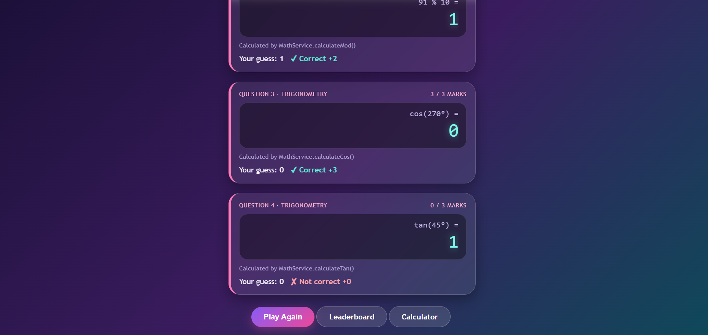
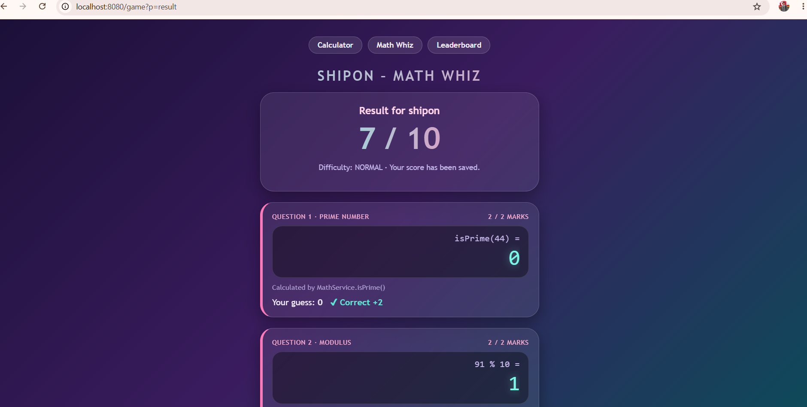
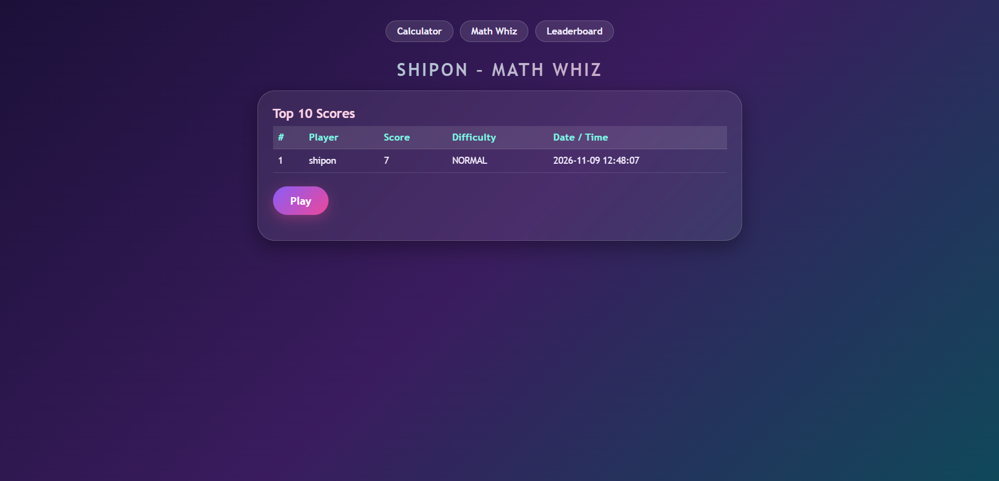

# SHIPON – MATH WHIZ

A web-based maths game (and a calculator) built with Java Servlets, JDBC and MySQL.
The system gives you numbers, you **guess** the answer, and then the calculator shows the
**real answer calculated by Java methods**. Scores are saved in a database and the top 10
are shown on a leaderboard.

## Project objectives
- Write reusable Java methods for prime numbers, modulus and trigonometry.
- Process forms on the server with a Servlet.
- Save and read data with JDBC and `PreparedStatement`.
- Show a sorted top-10 leaderboard from the database.

## Technologies used
- Java 11+, Java Servlet API 4 (javax.servlet)
- Embedded Apache Tomcat 9
- JDBC + MySQL (`mysql-connector-j`)
- Maven
- HTML, CSS, JavaScript (calculator keypad)

## Software requirements
- JDK 11 or newer
- Maven (IntelliJ IDEA has it built in)
- Internet connection the first time (to download libraries)
- A web browser

## Project structure
```
servlet-calculator/
├── pom.xml
├── README.md
├── database/math_whiz_db.sql
├── screenshots/                     (put your screenshots here)
└── src/main/java/calc/
    ├── Main.java                    starts Tomcat, registers both servlets
    ├── CalculatorServlet.java       the calculator + history (MySQL table "history")
    ├── GameServlet.java             the game: welcome, questions, result, leaderboard
    ├── MathService.java             isPrime, calculateMod, calculateSin/Cos/Tan, scoring
    ├── ScoreDAO.java                JDBC code for the game_scores table
    ├── DbConfig.java                MySQL host / user / PASSWORD settings (edit your password here)
    ├── GameScore.java               model for one score row
    └── MathServiceTest.java         simple tests (run its main method)
```

## Database configuration (MySQL Workbench)
1. Install/start **MySQL Server** (port 3306) and open **MySQL Workbench**.
2. In Workbench create a connection: Hostname `127.0.0.1`, Port `3306`, Username `root`,
   password = yours. Test Connection, then open it.
3. Open `src/main/java/calc/DbConfig.java` and set `PASSWORD` to your MySQL password
   (and `USER` / `HOST` / `PORT` if different).
4. Run the app. It creates the database **math_whiz_db** and the tables **game_scores**
   (leaderboard) and **history** (calculator) automatically.
   You can also run `database/math_whiz_db.sql` by hand in Workbench.
5. In Workbench press the refresh icon in SCHEMAS to see `math_whiz_db` and its data:
   `SELECT * FROM math_whiz_db.game_scores;`

Leaderboard query:
```sql
SELECT * FROM game_scores ORDER BY score DESC, played_at ASC LIMIT 10;
```

## Steps to run
**IntelliJ IDEA:** open the folder, wait for Maven to import, open
`src/main/java/calc/Main.java`, click the green play button next to `main`.

**Terminal:** `mvn compile exec:java`

Then open:
- Calculator: http://localhost:8080/
- Game: http://localhost:8080/game
- Leaderboard: http://localhost:8080/game?p=leaderboard

To test the maths methods, run the `main` method of `MathServiceTest`
(or `mvn compile exec:java -Dexec.mainClass=calc.MathServiceTest`).

## Game rules and scoring
Difficulty: **NORMAL** (stored in the database with every score).

| Question | Area | What you guess | Marks |
|---|---|---|---|
| Q1 | Prime number | `1` if prime, `0` if not | 2 |
| Q2 | Modulus | remainder (whole number) | 2 |
| Q3 | Trigonometry (sin/cos) | value to 2 decimals | 3 |
| Q4 | Trigonometry (sin/cos/tan) | value to 2 decimals | 3 |
| | | **Total** | **10** |

- A wrong answer earns 0 marks for that question.
- Angles are in degrees (converted to radians inside the Java methods).
- Decimal guesses are accepted within ±0.01 of the real answer.
- The divisor in the modulus question is never 0, and `calculateMod` throws an error if it is.
- Tangent is never asked at undefined angles (90°, 270°).

## Application screenshots
Add your own screenshots to the `screenshots` folder, then these links will work.

### Welcome Page


### Game Page


### Result Page


### Leaderboard


## GitHub project directory link
https://github.com/username/repository/tree/main/servlet-calculator
